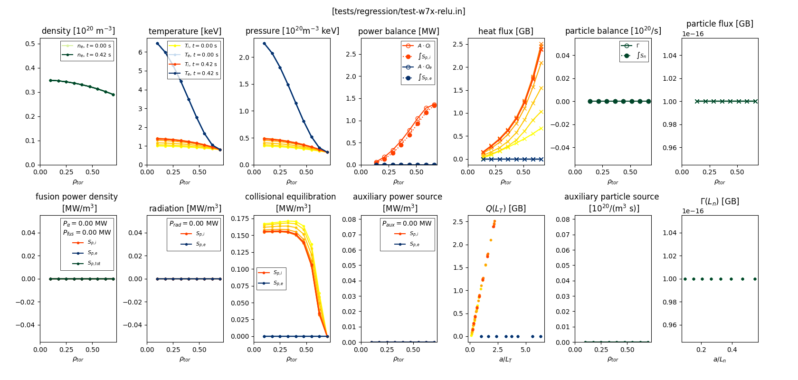
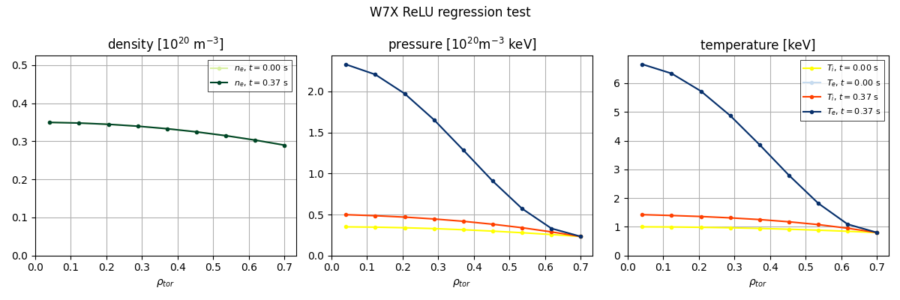
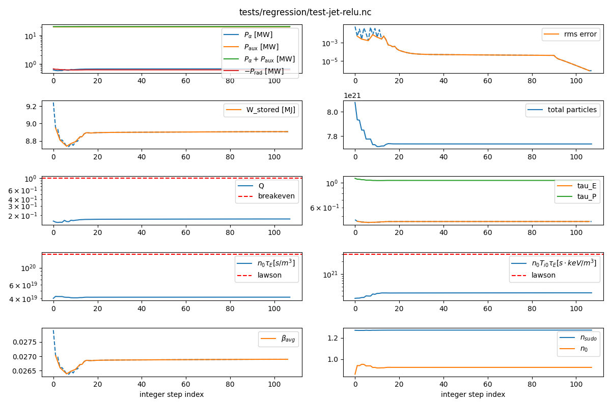
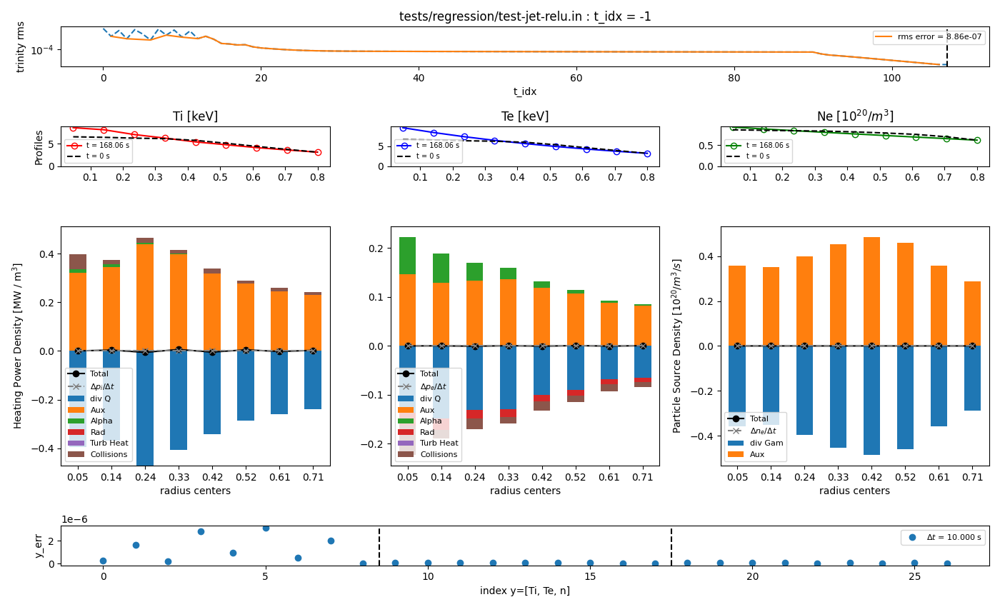

.. _quickplotting:
  
Plotting your T3D simulation results
++++++++++++++++++++++++++++++++++++

Profile Plotting
================

T3D data is written to a python pickle file (``.npy``), a NetCDF4 file (``.nc``), and ADIOS2 output (``.bp``). All can be used by the ``t3d-plot`` plot utility.

To create a panel summary plot of your results, use

.. code-block:: bash

  t3d-plot tests/regression/test-w7x-relu.log.npy
  t3d-plot tests/regression/test-w7x-relu.nc
  t3d-plot tests/regression/test-w7x-relu.bp

The ``t3d-plot`` utility can also be used to generate individual plots

.. code-block:: bash

  t3d-plot tests/regression/test-w7x-relu.bp -p density

Multiple-plots can be created using a space-separated list of plot names

.. code-block:: bash

  t3d-plot tests/regression/test-w7x-relu.bp -p density temperature

Use the ``-l`` option to see a list of available plot functions

.. code-block:: bash

  t3d-plot tests/regression/test-w7x-relu.bp -l

You can also create custom panel plots from the list of available plots

.. code-block:: bash

  --panel rows cols          Create a panel plot from a list of plots
  --figsize rowsize colsize  Specify the figure size
  --title TITLE              Specify a title for the custom panel

Other useful arguments include

.. code-block:: bash

  -g, --grid     to add a grid to the plot
  -s, --savefig  to save the figure to a pdf file (skips view)

  -t TIDX [TIDX ...], --tidx TIDX [TIDX ...]
                 space separated list of time indices to plot (use -1 for the last time index);
                 default plots all time slices
  -i, --show_newton_iterations, --show-newton-iterations
                 Plot intermediate Newton iterations
  --list-times   to list the profile times and indices

  -r RIDX [RIDX ...], --ridx RIDX [RIDX ...]
                 space separated list of rho indices to plot; default plots all rho indices

For example, to create a custom panel plot for the initial and final profiles of density, pressure, and temperature

.. code-block:: bash

  t3d-plot tests/regression/test-w7x-relu.bp -g -t 0 -1 -p density pressure temperature --panel 1 3 --figsize 12 4 --title "W7X ReLU regression test"

Timeseries Plots
================

The ``t3d-time-plot`` utility creates a panel plot of various T3D outputs versus step index.

.. code-block:: bash

  t3d-time-plot tests/regression/test-jet-relu.log.npy
  t3d-time-plot tests/regression/test-jet-relu.nc
  t3d-time-plot tests/regression/test-jet-relu.bp

Available arguments include

.. code-block:: bash

  -h, --help            show this help message and exit
  -s, --save            Save plots to file rather than interactive display
  -o OUTDIR, --outdir OUTDIR
                        Specifies an output directory
  -n, --skip-newton-iterations
                        Skip Newton iterations

Source Sink Plots
=================

The ``t3d-source-sink-plot`` utility creates a panel plot which will give insight into the sources and sinks.

.. code-block:: bash

  t3d-source-sink-plot tests/regression/test-jet-relu.log.npy
  t3d-source-sink-plot tests/regression/test-jet-relu.nc
  t3d-source-sink-plot tests/regression/test-jet-relu.bp

