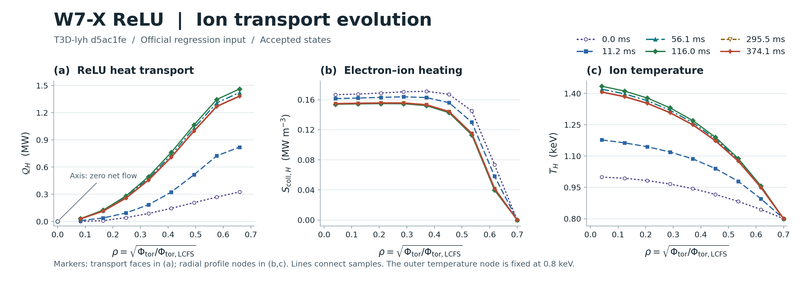
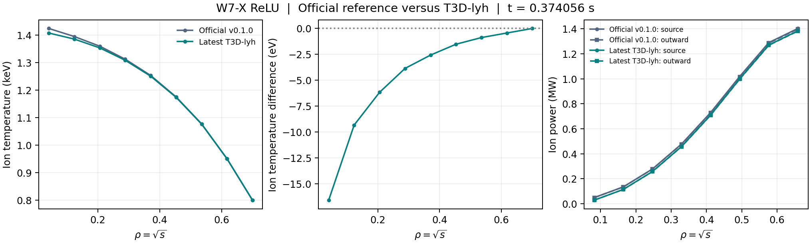

# W7-X ReLU：T3D-lyh 回归算例

[在线算例页](https://yihui-l.github.io/T3D-websites/W7X-ReLU-lyh/) · [源码手册](../Source-Code/README.md)

以同一个官方输入和 VMEC 平衡，比较上游 v0.1.0（`74a06dfdf8e005e6bc72ef79859413ba69abd626`）的随附参考结果与 `T3D-lyh`（`d5ac1fe128b7ab0c841b213890e7e9d8b56920f3`）重跑结果。输入和几何文件字节相同。环境没有 ADIOS2，所以本次只在运行器中关闭 BP 写出，保留 NetCDF，不修改输入、物理模型、数值设置和源码。维护版新增的文件通量接口未启用。

## 算例设置

- 几何：固定 `tests/data/wout_w7x.nc`。径向坐标是归一化环向磁通的平方根；9 节点、8 活动壳；边界 ρ = 0.7，外侧活动通量面 ρ = 0.6588235294。
- 组分：电子和 H⁺ 密度固定；电子温度固定，只演化氢离子能量。氢离子初始核心/边界温度 1.0/0.8 keV，电子 6.7/0.8 keV，密度 0.35/0.29 × 10²⁰ m⁻³。
- 输运：局域阈值模型 ReLU；氢离子热流阈值 0.1、斜率 1.2，`D_neo = 0`。电子热流及粒子通量斜率为零；轴上净径向通量为零。
- 源：已规定的电子背景通过电子–离子碰撞给 H⁺ 加热；辅助粒子与功率源幅度为零。只解氢离子能量，不解电子的反向冷却。
- 时间：`dtau = 0.1`（3.741 ms）、`t_max = 10`（0.374056 s）、`alpha = 1`；Newton `newton_threshold = 0.01`、`newton_tolerance = 0.02`、`max_newton_iter = 3`。

## 结果

最内侧氢离子温度从 0.9993 keV 上升到 116.0 ms 时的 1.4345 keV，终态回落到 1.4067 keV。最外活动面热功率从 0.3263 MW 升高，116.0 ms 时为 1.4612 MW，最终是 1.3822 MW。碰撞热源随电子与离子温差缩小而减弱。

| 终态指标 | 官方 | T3D-lyh |
| --- | ---: | ---: |
| 接受步数 | 8 | 8 |
| 物理终点（s） | 0.3740557727 | 0.3740557727 |
| 最内侧 H⁺ 温度（keV） | 1.42330319 | 1.40673474 |
| 活动域碰撞热源（MW） | 1.40318802 | 1.38431469 |
| 最外活动面热功率（MW） | 1.39921240 | 1.38217410 |
| 末步储能变化率（kW） | 3.986471 | 2.140711 |
| 全域功率残差绝对值（W） | 10.8496 | 0.1170 |
| 内部面未抵消量，带符号（W） | −74.5305 | 0 |

终态最大温差为 16.568 eV（最内侧节点）；两版的电子温度、密度和边界离子温度一致。中间接受时刻不同，不应按步号相减。两版分别在各自的接受态和各自几何权重上重算功率诊断；原版参考文件直接记录的最终热功率未与末态同步，不能替代重算值。全域残差为 `|dW/dt − (Pcoll − Qout)|`，储能变化率按各自接受步的变步长 BDF2 算出。内部面未抵消量不等同于全域残差。结果比较数值回归，不是实验验证。

## 数据字典

- `data/{official,lyh}-accepted.nc`：仅保留初值与 8 个接受态。`time_s(time)` 为物理秒；`rho_node` 含固定边界，`rho_face` 仅含活动通量面，`rho_active` 不含固定边界。`T_H_keV`、`T_e_keV`、`n_H_SI20`、`S_coll_H_MW_m3` 位于节点；`Q_H_MW`、`P_coll_inside_MW` 位于通量面；`shell_volume_m3` 位于活动壳层。`S_coll_H_MW_m3` 的固定边界为零，不计入预算。物理单位已转换；这两个净化导出**不是**可直接作为 T3D 源/通量输入的原生 restart 文件。
- `data/flux-faces.csv` 和 `data/source-temperature-nodes.csv`：维护版 9 个状态逐通量面／节点的平坦表。
- `data/time-history.csv`：两版的物理时刻、最内侧温度、最外活动面的热功率及积分热源。
- `data/{final-profiles,power-balance}.csv` 与 `data/comparison.json`：最终温度对比、磁面功率和指标；JSON `provenance` 列出官方输入、平衡和参考输出的 SHA-256。
- `figures/time-profiles.pdf` 是六时刻剖面的矢量版；两个 PNG 与相应 CSV 使用相同算例和比较口径。

## 复现

1. 选择对应的 [T3D-lyh 源码快照](https://github.com/Yihui-L/T3D-websites/tree/aa465f80087c3b07470adcd6e01c70d7fc6a9cd6/Source-Code/T3D-lyh) 并安装依赖。上游来自 [gyrokinetics/t3d v0.1.0](https://bitbucket.org/gyrokinetics/t3d/src/74a06dfdf8e005e6bc72ef79859413ba69abd626/)。
2. 在独立运行目录放入本目录的原样 `test-w7x-relu.in`，并确保 `tests/data/wout_w7x.nc` 可从当前工作目录解析到源码快照内的文件。
3. 执行 `t3d test-w7x-relu.in -l w7x-relu.out`。原样输入会请求 BP 和 NetCDF 双输出；若当前依赖只允许 NetCDF，只在运行副本中关闭 `output_adios2`，而不改其它设置。
4. 官方对照取上游 `tests/regression/ref-w7x-relu.nc`。从 NetCDF 保留 `t_iter_idx == 0` 的记录，维护版另要求 `t_diagnostics_valid == 1`；用 `t_ref` 将 `time/t` 转换为秒。在同步后的各态比较功率；不要把 Newton 中间迭代当作额外的时间帧。
